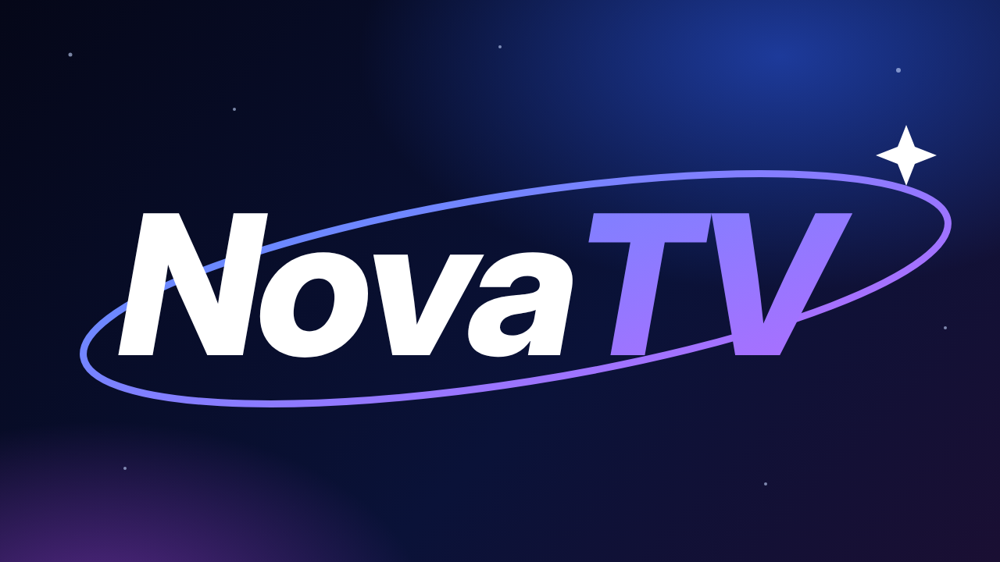
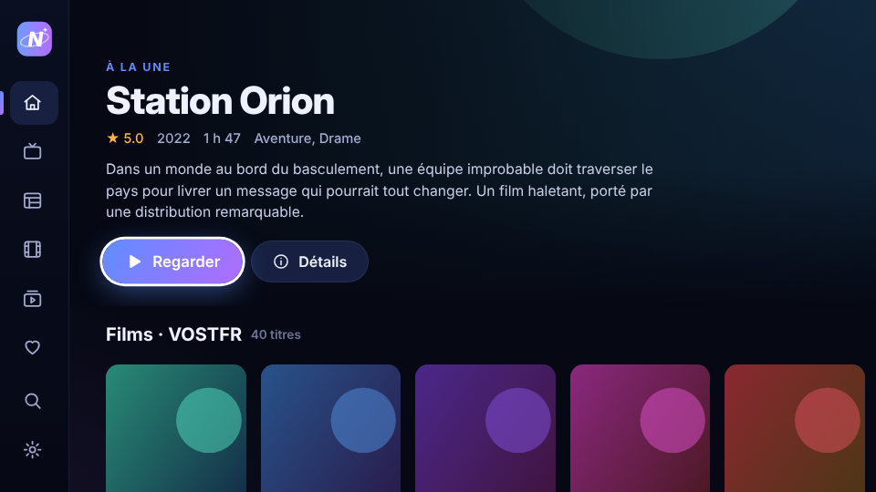
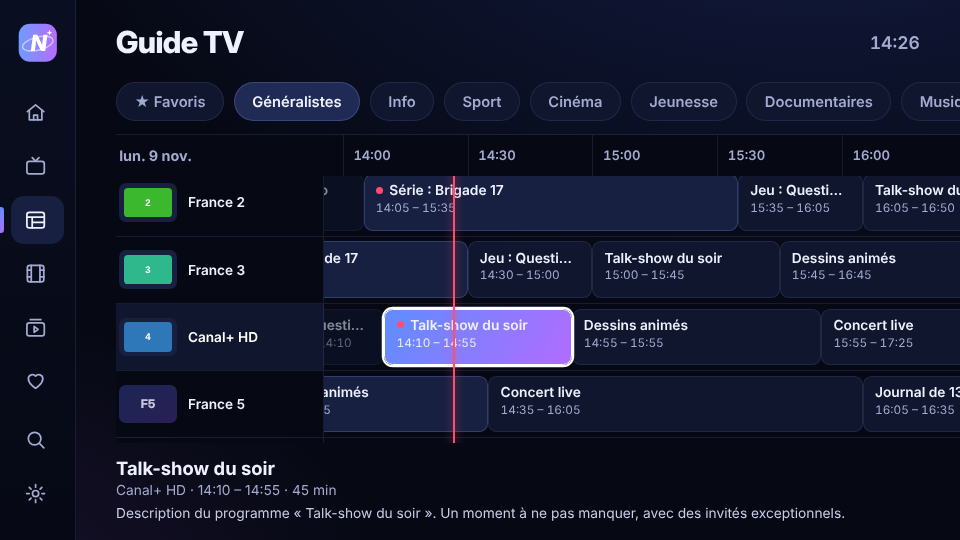
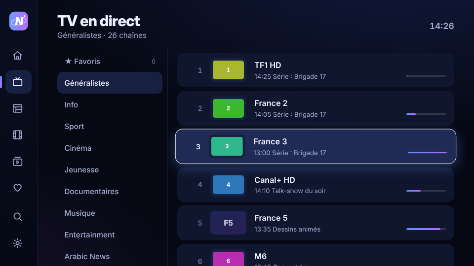
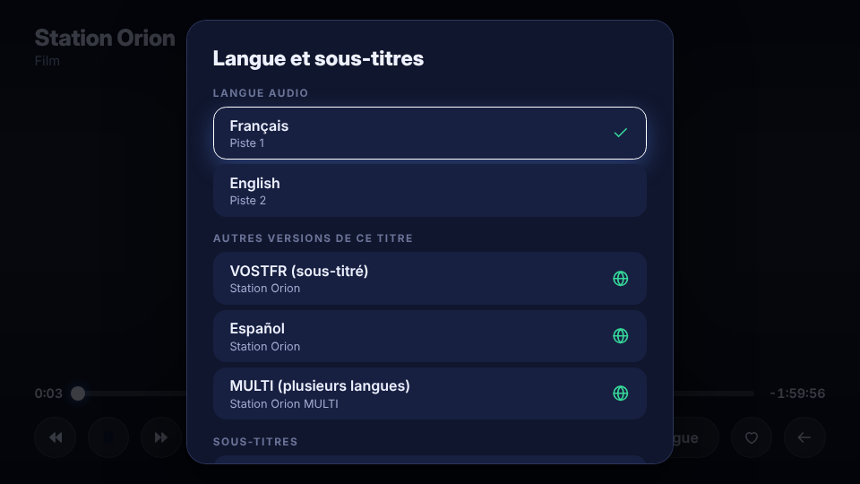
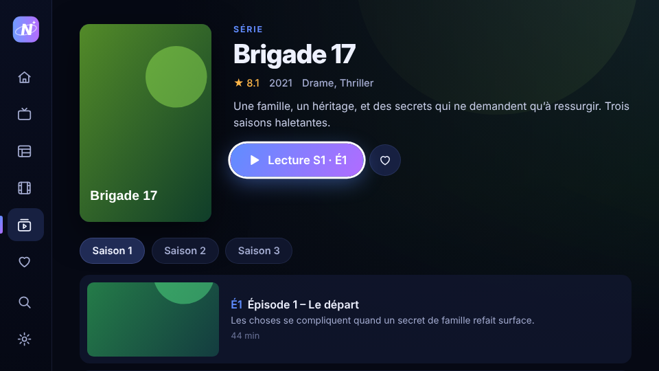
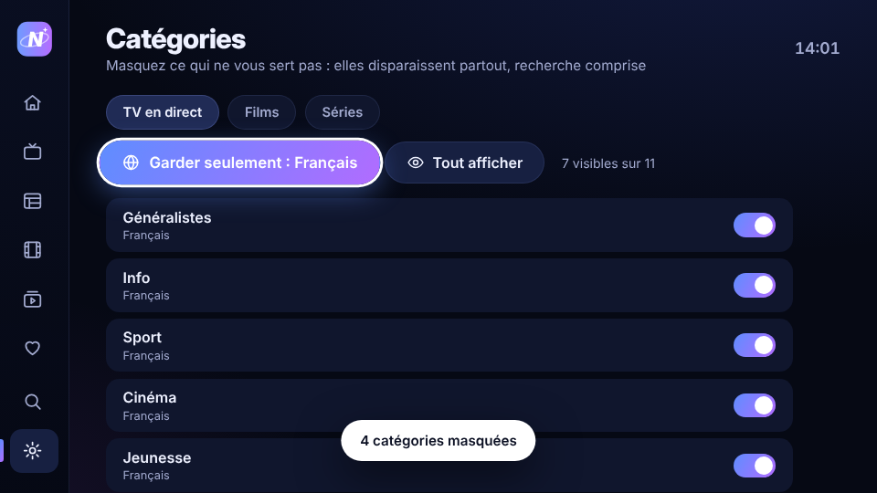
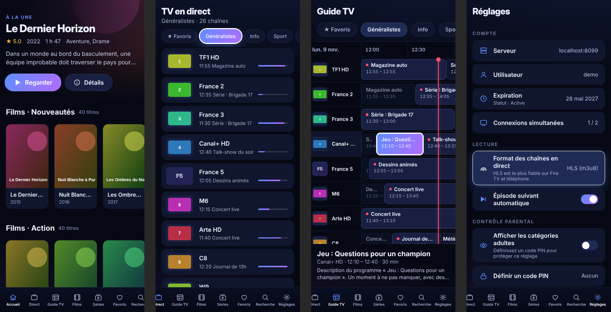

<p align="center"></p>

<p align="center">
<b>Lecteur IPTV élégant et rapide pour Fire TV et téléphones Android</b><br>
Télécommande ou écran tactile · moteur VLC intégré · français par défaut<br>
<sub>Créé par <b>Rappace</b> · logiciel libre sous licence MIT</sub>
</p>

<p align="center">
<a href="https://github.com/RappaceFer/NovaTV/raw/main/release/NovaTV-v2.0.1.apk"><b>⬇ Télécharger (Fire TV et téléphone)</b></a> ·
<a href="#-soutenir-le-projet"><b>❤ Faire un don</b></a>
</p>

---

## Aperçu

| Accueil | Guide TV |
|---|---|
|  |  |
| **TV en direct** | **Langue et sous-titres** |
|  |  |
| **Fiche série** | **Catégories masquées** |
|  |  |

<p align="center"></p>

## Fonctionnalités

- **Une seule appli pour Fire TV et téléphone** : menu latéral et navigation à la télécommande sur TV, barre d’onglets et tactile sur téléphone.
- **Connexion Xtream Codes** : serveur, utilisateur et mot de passe, ou collez directement votre lien M3U.
- **TV en direct** avec programme en cours, zapping haut/bas, chaînes récentes et favorites.
- **Guide TV** en grille sur 8 heures, avec l’heure actuelle et le résumé des programmes.
- **Films et séries** : fiches détaillées, saisons, épisodes **vus** marqués, reprise là où vous vous êtes arrêté (ou épisode suivant), épisode suivant automatique.
- **Historique modifiable** : appui long pour retirer un titre de « Reprendre » ou une chaîne récente, effacement dans les réglages.
- **Moteur VLC intégré** : lit MKV, MP4, AVI, TS, HLS (H.264, HEVC, MPEG-2, Xvid…) ; choix de la **langue audio** et des **sous-titres** dans le lecteur.
- **Lecteur plein écran natif** : la vidéo s’affiche dans un vrai calque Android, sans page web devant ; les commandes NovaTV sont dessinées par-dessus avec le même style ; seule la partie qui change (bouton en surbrillance, temps) est redessinée, pour un menu fluide même sur Fire TV.
- **Lecture qui ne lâche pas** : décodage logiciel automatique si la puce vidéo refuse un format ou fige l’image, reprise au même endroit si le serveur coupe.
- **Français par défaut** : langue audio et sous-titres choisis automatiquement, catégories françaises en tête.
- **Autres versions d’un titre** (VF, VOSTFR, MULTI…) proposées directement dans le lecteur.
- **Catégories masquées** : retirées des listes, du guide, de l’accueil et de la recherche ; bouton « Garder seulement le français ».
- **Bandes-annonces** lues dans l’appli, serveurs publicitaires bloqués.
- **Appui long sur OK** : ajoute aux favoris (chaînes, films, séries) ou masque une catégorie.
- **Contrôle parental** par code PIN, reconnexion automatique en cas de coupure.

## Installation sur Fire TV

1. Sur la Fire TV : **Paramètres › Ma Fire TV › Options pour les développeurs**, autorisez les applis inconnues pour **Downloader**.
2. Dans Downloader, saisissez ce lien :
   ```
   https://github.com/RappaceFer/NovaTV/raw/main/release/NovaTV-v2.0.1.apk
   ```
3. Installez, puis ouvrez **NovaTV** et connectez votre abonnement.

Sur téléphone : [téléchargez l’APK](https://github.com/RappaceFer/NovaTV/raw/main/release/NovaTV-v2.0.1.apk) (la même que pour la Fire TV) et ouvrez-le (autorisez l’installation depuis votre navigateur si Android le demande).

> Android 8 ou plus récent (Fire OS 7 et plus). Une seule APK pour Fire TV et téléphone (conçue pour Android 14, acceptée par Play Protect). Processeurs ARM (toutes les Fire TV et la quasi-totalité des téléphones).

## ❤ Soutenir le projet

NovaTV est gratuit et sans publicité. **Les dons sont les bienvenus** et aident à continuer à l’améliorer :

- **PayPal** : _lien à venir_
- **Ko-fi** : _lien à venir_
- Ou via le bouton **Sponsor** en haut de cette page.

Merci ! 🙏

## Avertissement

NovaTV est **uniquement un lecteur**. Il ne fournit, n’héberge et ne vend **aucune chaîne, aucun film ni aucune série**.
Vous devez utiliser un abonnement IPTV légal, dont vous détenez les droits. Les auteurs ne sont pas responsables de
l’usage qui est fait de l’application.

## Construire l’APK soi-même

Aucun SDK Android n’est nécessaire : la coque Android (`classes.dex`, manifeste binaire, ressources) est générée par des
scripts Python dans [`android/`](android/), l’interface est en HTML/CSS/JS dans [`app/`](app/).

```bash
# Prérequis : Python 3 (+ module cryptography), Java (keytool, jarsigner)
export NOVATV_VENDOR_APK=/chemin/vers/apk-contenant-libvlc.apk   # fournit LibVLC (dex + libs ARM)
export NOVATV_KS_PASS='un-mot-de-passe-solide'
./android/build.sh          # → android/out/NovaTV-v2.0.1.apk (Fire TV et téléphone)
```

Le keystore de signature (`novatv.jks`) est créé au premier lancement. Les versions officielles sont signées par **Rappace** ; une APK signée par quelqu’un d’autre ne peut pas s’installer par-dessus. **Ne le publiez jamais** : il est ignoré par git,
et c’est lui qui permet aux utilisateurs d’installer les mises à jour par-dessus l’ancienne version.

Structure :

| Dossier | Contenu |
|---|---|
| `app/` | Interface (index.html, app.js, app.css, polices, page de bande-annonce) |
| `android/dex.py` | Génère `classes.dex` : activité plein écran, WebView, calque lecteur natif, pont JavaScript vers LibVLC, blocage pub |
| `android/res.py` | Génère `AndroidManifest.xml` binaire et `resources.arsc` |
| `android/dexcheck.py` | Vérifie et désassemble le dex généré |
| `android/pack.py`, `align4.py` | Assemblent et alignent l’APK |
| `android/apksign.py` | Signature APK v2 (Android 11+) et vérification |

## Licence

**© 2026 Rappace.** NovaTV est un logiciel libre et open source sous licence [MIT](LICENSE) :
vous pouvez l’utiliser, le modifier et le redistribuer, à condition de conserver la mention de copyright de Rappace. Composants tiers (LibVLC, police Inter…) : voir [THIRD_PARTY.md](THIRD_PARTY.md).
